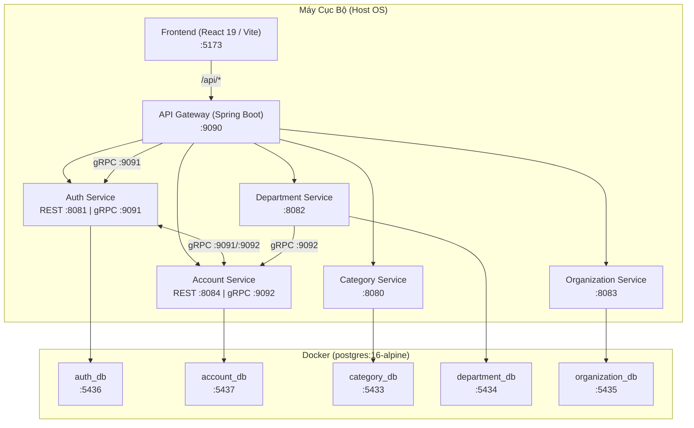

# Hướng Dẫn Khởi Chạy Môi Trường Phát Triển Cục Bộ (Dev Environment)

Tài liệu này hướng dẫn cách khởi chạy toàn bộ hệ thống (Frontend + 6 Backend Microservices + 5 Databases) bằng **1 lệnh duy nhất** thông qua script `start-dev.sh` đặt tại thư mục `docs/`.

---

## 1. Tổng Quan Kiến Trúc Khi Chạy Dev

Hệ thống được thiết kế theo tiêu chí **nhẹ - mát máy - khởi động nhanh**:
- **Chạy trên Host (Java 21 / Node.js)**: Không đóng gói ứng dụng vào Docker. Toàn bộ 6 microservice chạy trực tiếp bằng OpenJDK 21 với cờ giới hạn RAM `-Xmx256m -Xms64m`, giúp tiết kiệm tối đa tài nguyên máy.
- **Chạy trên Docker**: Chỉ chạy duy nhất 5 container PostgreSQL dạng Alpine (`postgres:16-alpine`), chiếm tổng cộng chưa tới **100MB RAM**.
- **Tự trị 100% trong `docs/`**: Toàn bộ Frontend và Backend Services đều nằm trong thư mục `docs/`.
- **Loại trừ**: Tạm thời loại bỏ `file-service` (OCR), `ai-service` (RAG AI), MinIO, RabbitMQ và Qdrant để tránh tiêu tốn CPU/GPU/RAM.



---

## 2. Bảng Phân Bổ Cổng & Cơ Sở Dữ Liệu

| Phân hệ | Cổng Service | Cổng Database (Docker) | Tên Database | Username / Password |
| :--- | :--- | :--- | :--- | :--- |
| **Frontend** | `http://localhost:5173` | — | — | — |
| **API Gateway** | `http://localhost:9090` | — | — | — |
| **Auth Service** | `http://localhost:8081` *(gRPC :9091)* | `localhost:5436` | `auth_db` | `postgres` / `Bao1234567890@` |
| **Account Service** | `http://localhost:8084` *(gRPC :9092)* | `localhost:5437` | `account_db` | `postgres` / `postgres` |
| **Category Service** | `http://localhost:8080` | `localhost:5433` | `category_db` | `postgres` / `postgres` |
| **Department Service** | `http://localhost:8082` | `localhost:5434` | `department_db` | `postgres` / `postgres` |
| **Organization Service**| `http://localhost:8083` | `localhost:5435` | `organization_db` | `postgres` / `postgres` |

---

## 3. Yêu Cầu Môi Trường (Prerequisites)

1. **Java Runtime**: OpenJDK 21 (Temurin, Microsoft, hoặc Oracle JDK 21). Script sẽ tự động nhận diện qua `/usr/libexec/java_home -v 21` trên macOS.
2. **Node.js & npm**: Node.js v20+ hoặc v22+.
3. **Docker Desktop**: Cần bật Docker Desktop để khởi chạy 5 cơ sở dữ liệu. *(Nếu chưa bật, script sẽ thử tự mở ứng dụng trên macOS)*.

---

## 4. Các Lệnh Sử Dụng Chính

Toàn bộ lệnh được thực thi bên trong thư mục `docs/`:

```bash
cd docs
```

### 4.1. Khởi chạy toàn bộ hệ thống (Chạy 1 lần)
```bash
./start-dev.sh
```

**Quy trình script tự động xử lý**:
1. Kiểm tra môi trường Java 21 và Docker Desktop.
2. Khởi động 5 container PostgreSQL qua `docker-compose.db.yml` và kiểm tra sẵn sàng (`pg_isready`).
3. Khởi động ngầm 6 dịch vụ Java bằng các gói JAR siêu nhẹ (hoặc qua Maven Spring Boot nếu chưa build).
4. Kiểm tra sức khỏe các cổng mạng (8080, 8081, 8082, 8083, 8084, 9090).
5. Khởi chạy Frontend Vite (`npm run dev`) ở foreground để bạn theo dõi log và mở trình duyệt tại `http://localhost:5173`.

> [!NOTE]
> **Cách dừng**: Nhấn `Ctrl+C` tại cửa sổ terminal đang chạy script. Toàn bộ tiến trình Java và Frontend sẽ dừng lại an toàn ngay lập tức. Các container DB vẫn giữ nguyên để lần sau bạn bật lại nhanh hơn.

---

### 4.2. Dừng toàn bộ hệ thống & Tắt cả Docker Database
Khi bạn kết thúc buổi làm việc và muốn tắt sạch mọi thứ:
```bash
./start-dev.sh stop
```
Lệnh này sẽ tắt các service Java, tắt Frontend và gọi `docker compose down` để giải phóng hoàn toàn tài nguyên.

---

### 4.3. Kiểm tra trạng thái hệ thống
Xem danh sách các database container và các cổng dịch vụ đang lắng nghe:
```bash
./start-dev.sh status
```

---

### 4.4. Xem log chi tiết của từng service khi cần debug
Các file log được lưu tự động trong thư mục `docs/.logs/`. Bạn có thể theo dõi trực tiếp:
```bash
./start-dev.sh logs auth          # Theo dõi log auth-service
./start-dev.sh logs account       # Theo dõi log account-service
./start-dev.sh logs category      # Theo dõi log category-service
./start-dev.sh logs department    # Theo dõi log department-service
./start-dev.sh logs organization  # Theo dõi log organization-service
./start-dev.sh logs gateway       # Theo dõi log api-gateway
```

---

### 4.5. Đóng gói lại các gói JAR (Khi có chỉnh sửa code Backend)
Nếu bạn thay đổi mã nguồn Java của bất kỳ microservice nào, hãy chạy lệnh sau để build lại các file `.jar`:
```bash
./start-dev.sh build
```
Khi có file `.jar` trong thư mục `target/`, script sẽ tự động kích hoạt chế độ chạy siêu tốc `java -jar` thay vì thông qua Maven daemon.

---

## 5. Tài Khoản Đăng Nhập Mẫu

`auth-service` và `account-service` đã được kích hoạt tính năng seed dữ liệu mẫu (`APP_SEED_ENABLED=true`), bạn có thể đăng nhập ngay trên giao diện Frontend:

| Vai trò (Role) | Username | Password | Quyền hạn |
| :--- | :--- | :--- | :--- |
| **Quản trị viên (ADMIN)** | `admin` | `Admin@123` | Toàn quyền quản trị tài khoản, danh mục, phòng ban, cơ quan |
| **Trưởng phòng (MANAGER)** | `manager` | `Manager@123` | Quản lý theo phạm vi phòng ban |
| **Chuyên viên (EMPLOYEE)** | `employee1` | `Employee@123` | Tra cứu và lập văn bản |

---

## 6. Xử Lý Sự Cố Thường Gặp (Troubleshooting)

1. **Bị báo lỗi cổng bị chiếm (Port already in use)**:
   - Hãy chạy:
     ```bash
     ./start-dev.sh stop
     ```
     Script sẽ tự động tìm và kill các process tồn đọng trên các cổng 8080, 8081, 8082, 8083, 8084, 9090, 5173.
2. **Không kết nối được cơ sở dữ liệu**:
   - Chạy `./start-dev.sh status` để kiểm tra xem Docker daemon có hoạt động không.
   - Chạy `docker compose -f docker-compose.db.yml logs` để xem chi tiết log của Postgres.
3. **Frontend báo lỗi kết nối mạng**:
   - Kiểm tra xem `api-gateway` (port 9090) hoặc các service thành phần đã sẵn sàng chưa bằng lệnh `./start-dev.sh logs gateway`.
